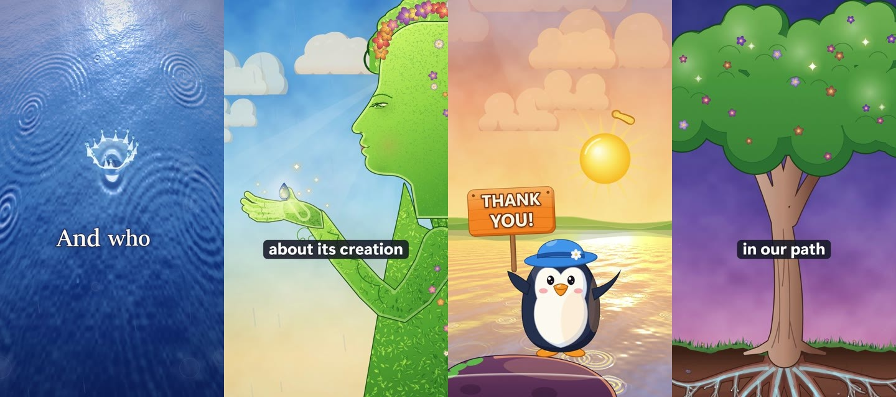
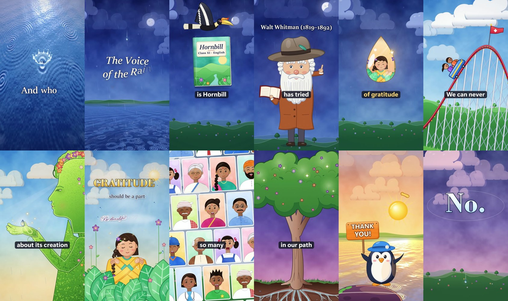

<div align="center">



# MOTION VIDEO SKILL

### Give Claude a talking-head video. Get back a film.

*Illustrated worlds · word-timed kinetic captions · characters that react to what is said · a score that never fights the voice*

 

</div>

---

## What it is

A Claude Code skill (and plugin) that turns **any video of someone speaking** (a lesson, a talk, an explainer, an interview, in any language) into an **art-directed motion-graphics film**. It was distilled from a real project: a 3 min 41 s, 9:16, 60 fps film with 146 shots, three rounds of critics, and an owner who kept saying *"make it more colourful"*.

It does not slap templates on your clip. It **asks you what the film is for, picks one visual world from your content, draws illustrations for the exact words being spoken, scores it, checks it, and renders it.**

| You say | The skill does |
|---|---|
| "Make this lecture look like an insta reel" | asks 3-4 quick questions, then builds the whole film |
| "Here's the poem he's quoting" | quotes it **word for word** on cards, with a highlighter that follows his voice |
| "I won't be around, finish it" | decides for you, saves progress, resumes itself after usage limits, pings you when done |

## The look

<div align="center">



*Frames from the film this skill was built on. Rain, roots, Mother Earth, a hornbill, a roller coaster, a sunrise. All drawn in code, on the spoken words.*

</div>

## How it works

```
 INTAKE ──► SCAFFOLD ──► CONCEPT ──► BEATS ──► SCENES ──► SOUND ──► QA ──► CRITICS ──► RENDER
 ask the     one         one visual   a new     illustrate  score,    0 FAIL  3 critics   master, reel,
 user        command     world        device    each word   sfx,      checks  score ≥ 9   preview, poster,
 (defaults)  frames,     from the     every     on its      voice                          subtitles
             captions,   content      2-4 s     cue         floor
             starter
             film
```

1. **Intake.** A short, structured questionnaire (purpose, platform, aspect, text to quote, look references, music mood, must-haves, deliverables, how autonomous to be). Every question has a default, so "you decide" works.
2. **Scaffold.** `new_project.py` extracts frames and audio, finds the face in every frame, transcribes with word timestamps, writes the project, and produces a **starter film that already renders**.
3. **Concept.** One visual metaphor and one light clock for the whole film (v4 runs from rainy blue night to a golden sunrise on the word *"Thank you"*).
4. **Beats.** Four shot types (`S` speaker, `X` split, `C` cutaway, `F` full graphic) cut on word onsets, something new every 2-4 s.
5. **Scenes.** Generative illustration kits (skies, water, hills, trees, roots, characters, cards, chapter steps, kinetic type), cued with `WT('word')` so every hit lands on its word.
6. **Sound.** A synthesized score and sound design, ducked under the voice, with every spoken word measured to sit at least **15 dB** above the bed. Mastered to -14 LUFS.
7. **QA.** Automatic checks on every shot: safe zones, text size, contrast, face never covered, quoted text verbatim, deterministic renders.
8. **Critics.** Fresh critics (jury, short-form editor, domain expert) score 11 criteria. Fix until 9 or better.
9. **Deliver.** Master, short reel, preview, poster, subtitles, chapters, caption text, and one tidy project folder.

## Design rules it will not break

- **The speaker is sacred.** Never covered, never keyed out. When shrunk he sits in a clean rounded card, with no blur border.
- **Your text is verbatim.** Names spelled the way you spell them.
- **Original art only.** Reference images guide style; they are never traced, copied, or put in the film.
- **Deterministic.** The same time gives the same pixels. Parallel renders never flicker.
- **Honest reports.** What was measured, and what could not be checked.

## Install

**As a plugin** (Claude Code):

```
/plugin marketplace add AyushDas4890/Motion-video-Skill
/plugin install motion-video-skill@motion-video-skill
```

**As a plain skill:** copy `skills/motion-video-skill/` into `~/.claude/skills/`.

**Needs** (the skill checks and tells you exactly what is missing; it installs nothing without asking): Python 3, ffmpeg, Node.js, Playwright with Chromium (GPU WebGL), faster-whisper. Windows, macOS and Linux work in principle; it was built and verified on Windows 11 with an NVIDIA GPU.

## Use it

Just talk to Claude:

> "Turn `lesson.mp4` into a colourful reel. Vertical. The poem he quotes is in `poem.txt`."

or run the scaffold yourself:

```bash
python skills/motion-video-skill/scripts/new_project.py --check-only
python skills/motion-video-skill/scripts/new_project.py --video lesson.mp4 --out my_film \
       --title "My Lesson" --speaker "Name" --text poem.txt --aspect 9:16
```

## What is inside

```
skills/motion-video-skill/
├─ SKILL.md                 the workflow Claude follows
├─ scripts/
│  ├─ new_project.py        one-command scaffold
│  └─ engine/               renderer, scene kits, QA, audio tools, parallel render
├─ references/              intake · art direction · lessons (every bug + fix) · critique · workflows · audio
├─ assets/                  brief, RESUME, auto-resume, final-report templates
└─ examples/voice-of-the-rain/   the complete worked scene set and beat sheet (code only)
```

## Built from a real production

Every rule in `references/lessons.md` is a scar: a shared WebGL canvas that overwrote the speaker, a seed that depended on call order, music that dipped 25 dB on one word, thin white roots the owner hated, a blur border that looked wrong. The skill carries those fixes so you do not repeat them.

## License

MIT. Illustrations in `docs/media` are frames from the author's film, shown for demonstration.
